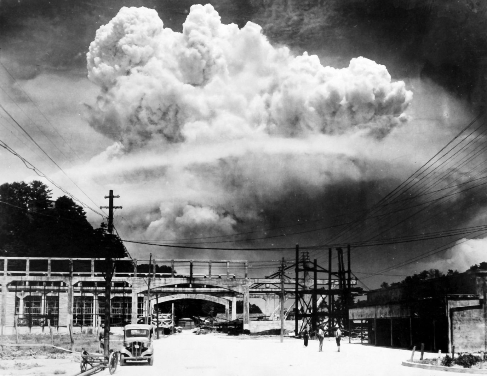
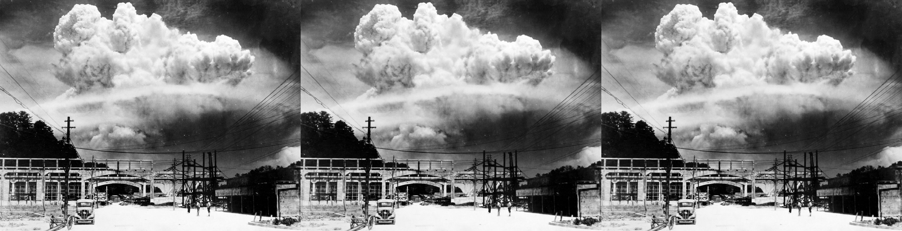
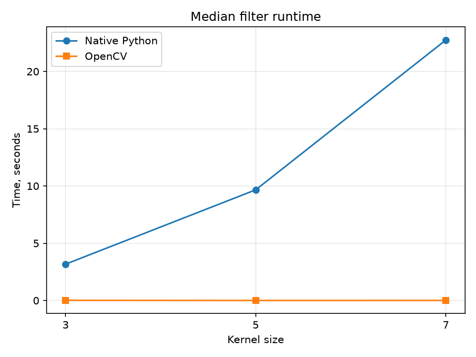

# Лабораторная работа №1 — медианный фильтр

## Теория

Медианный фильтр используется для удаления импульсного шума («соль и перец»), который появляется в виде случайных чёрных и белых точек.

Для каждого пикселя рассматривается область размером `k × k`. Значения яркости сортируются, а центральный пиксель заменяется медианой. Для окна `3 × 3` из 9 значений выбирается пятое значение после сортировки.

Размер ядра должен быть нечётным. При увеличении ядра шум удаляется сильнее, но мелкие детали могут потеряться.

## Описание разработанной системы

Программа загружает готовое изображение в оттенках серого и реализует медианный фильтр двумя способами: нативно на Python и с использованием OpenCV.

### Нативная реализация

В нативной версии программа загружает изображение в оттенках серого, расширяет его границы повторением крайних пикселей, обходит все пиксели и для каждого пикселя сортирует значения из окна `k × k`.

```python
neighborhood = []
for dy in range(kernel_size):
    for dx in range(kernel_size):
        neighborhood.append(int(padded[y + dy, x + dx]))
neighborhood.sort()
result[y, x] = neighborhood[len(neighborhood) // 2]
```

### Реализация OpenCV

В библиотечной версии используется готовая оптимизированная функция `cv2.medianBlur`:

```python
library = cv2.medianBlur(image, size)
```

### Измерение времени и проверка

Время работы измеряется через `time.perf_counter()`. После фильтрации результаты сравниваются по всем пикселям с помощью `np.array_equal` и максимальной абсолютной разницы.

## Результаты работы

### Исходное изображение


В эксперименте использована фотография городского пейзажа с исходными дефектами и шумом.

### Нативная реализация



### Реализация OpenCV


### Сравнение результатов

Слева находится исходное изображение, в центре — результат нативной реализации, справа — результат OpenCV.




### Время выполнения



Точные результаты измерений находятся в `results/results.csv`.

| Размер ядра | Python | OpenCV | Ускорение | Совпадение | Максимальная разница |
|---:|---:|---:|---:|:---:|---:|
| 3×3 | 4.246294 с | 0.011893 с | 357.04× | Да | 0 |
| 5×5 | 10.094964 с | 0.001064 с | 9484.78× | Да | 0 |
| 7×7 | 20.016900 с | 0.003323 с | 6024.57× | Да | 0 |

## Вывод

Медианный фильтр реализован двумя способами: вручную на Python и с помощью OpenCV. Нативная версия показывает внутренний принцип работы алгоритма, а OpenCV выполняет ту же операцию быстрее благодаря оптимизированной реализации.

После обработки результаты двух реализаций сравниваются по каждому пикселю. Совпадение результатов подтверждает корректность нативной реализации.

## Источники

1. [OpenCV — Median Blurring](https://docs.opencv.org/4.x/d4/d13/tutorial_py_filtering.html)
2. [OpenCV — функция `medianBlur`](https://docs.opencv.org/4.x/d4/d86/group__imgproc__filter.html)
3. [Python — функция `time.perf_counter`](https://docs.python.org/3/library/time.html#time.perf_counter)
4. [NumPy — функция `pad`](https://numpy.org/doc/stable/reference/generated/numpy.pad.html)
